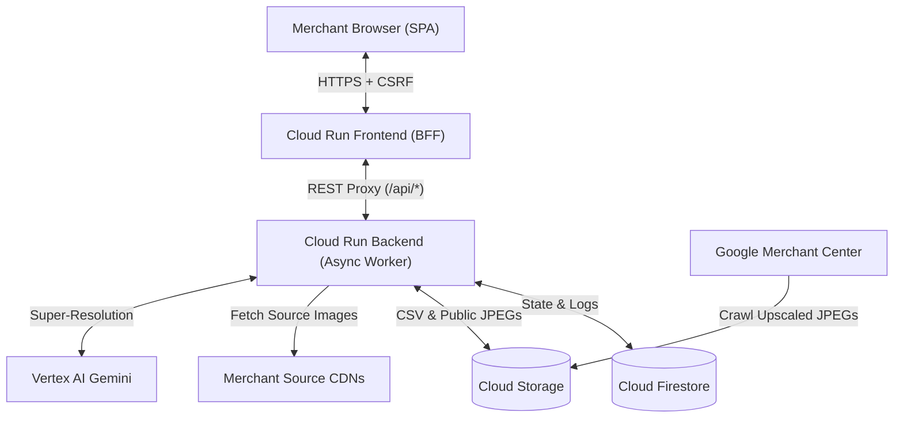

# ImageUpscaler — GMC Product Image Super-Resolution Platform

> **Disclaimer**: This is not an official Google product.

**ImageUpscaler** is a cloud-native product image super-resolution and
outpainting platform built for **Google Merchant Center (GMC)** catalog feeds on
Google Cloud Platform (`Cloud Run`, `Cloud Firestore`, `Cloud Storage`, and
`Vertex AI Gemini`).

It audits, deduplicates, upscales, and frames low-resolution e-commerce product
images (such as `< 500x500` Apparel or `< 250x250` General retail SKUs) into
high-resolution square catalog assets (`500x500` or `1500x1500` JPEG) hosted on
public Google Cloud Storage URLs ready for `Googlebot-Image` crawling.

---

## Table of Contents

1. [Key Features](#1-key-features)
2. [Architecture](#2-architecture)
3. [Super-Resolution Engines](#3-super-resolution-engines)
4. [Input & Output CSV Format](#4-input--output-csv-format)
5. [Configuration](#5-configuration)
6. [Deployment (Google Cloud)](#6-deployment-google-cloud)
7. [Local Development & Testing](#7-local-development--testing)
8. [Security Controls](#8-security-controls)
9. [License](#9-license)

---

## 1. Key Features

- **Google Merchant Center Feed Support**: Accepts primary (`image_link`) and
  additional (`additional_image_link`, up to 10 images per SKU) product image
  feeds in CSV or TSV format, and outputs ready-to-upload GMC supplemental
  feeds.
- **5 Pluggable Super-Resolution Engines**: Choose between deterministic CPU
  outpainting (`local-lanczos-canvas`), GPU super-resolution (`realesrgan`), or
  generative super-resolution via **Vertex AI** (`gemini-3.1-flash-lite-image`,
  `gemini-3.1-flash-image`, `gemini-3-pro-image`).
- **Non-Blocking Async Pipeline & Live Progress**: Queues jobs immediately and
  streams real-time SKU progress, ETA, and status updates (`QUEUED` ->
  `PROCESSING` -> `COMPLETED`).
- **Interactive Before / After Comparator & SKU Retry**: Inspect individual SKU
  conversions side-by-side and retry any SKU or failed batch with a different
  engine.
- **4-Layer Vertex AI Rate Limiter**: Prevents `429 RESOURCE_EXHAUSTED` quota
  errors via URL deduplication, bounded concurrency (`VERTEX_MAX_CONCURRENCY`),
  token-bucket QPM pacing (`VERTEX_MAX_QPM`), and exponential backoff.
- **Cost & Billing Estimator**: Compares per-image and batch costs across all
  five engines, backed by live Google Cloud Billing Catalog API synchronization.
- **9-Language APAC Localization**: Built-in UI support for Japanese (default),
  English, Simplified Chinese, Traditional Chinese, Korean, Indonesian, Thai,
  Vietnamese, and Hindi.

---

## 2. Architecture



### Core Components

- **Frontend (`gmc-upscaler-frontend`)**: FastAPI Backend-for-Frontend (BFF)
  serving the Material 3 Single-Page Application (`app/static/`) and proxying
  authenticated API calls.
- **Backend (`gmc-upscaler-backend`)**: FastAPI async worker executing image
  auditing, deduplication, super-resolution, and GCS uploads
  (`app/pipeline/orchestrator.py`).
- **Database (`Cloud Firestore`)**: Persists job metadata (`upscale_requests`),
  per-image conversion logs (`conversion_logs`), and pricing configuration
  (`pricing_config`), with an in-memory SQLite mock mode for local testing.
- **Object Storage (`Cloud Storage`)**: Stores public upscaled JPEGs
  (`img/{eng}{px}/{hash10}.jpg`), offloaded large CSV feeds
  (`requests/<id>/input|output.csv`), and daily audit logs
  (`status/{YYYYMMDD}/log.csv`).

---

## 3. Super-Resolution Engines

| Engine ID | Mode | Typical Latency | Est. Cost / Image | Best For |
| :--- | :--- | :---: | :---: | :--- |
| `local-lanczos-canvas` | CPU Lanczos-3 + White Canvas | `~0.05s` | `$0.000016` | Default zero-hallucination framing (70–80% of catalogs) |
| `realesrgan` | L4 GPU / Unsharp + Lanczos-3 | `~0.25s` | `$0.000159` | Fast edge sharpening without generative changes |
| `gemini-3.1-flash-lite-image` | Vertex AI Nano Banana 2 Lite | `~4.5s` | `$0.01682` | Low-cost generative upscale for sub-250px thumbnails |
| `gemini-3.1-flash-image` | Vertex AI Nano Banana 2 Std | `~6.0s` | `$0.04502` | High-definition 2K detail recovery for apparel & decor |
| `gemini-3-pro-image` | Vertex AI Nano Banana Pro | `~8.5s` | `$0.06702` | Flagship fidelity for hero SKUs and complex textures |

---

## 4. Input & Output CSV Format

### 4.1 Input CSV
Supports standard Google Merchant Center CSV or TSV files containing:
- `id` (or `sku`, `item_id`, `product_id`)
- `image_link` (or `image_url`, `url`)
- `additional_image_link` *(optional)* — up to 10 additional image URLs per
  product (comma-separated, pipe-separated, or repeated/numbered
  `additional_image_link` columns; URLs containing literal commas may be quoted
  or `%2C`-encoded).
- Headerless single-column URL lists are also supported.
- Supported source image formats: `JPEG`, `PNG`, `WEBP`, `GIF`, `BMP`, `TIFF`.

```csv
id,image_link,additional_image_link
SKU-1001,https://cdn.example.com/1001_main.jpg,"https://cdn.example.com/1001_side.jpg,https://cdn.example.com/1001_back.jpg"
SKU-1002,https://cdn.example.com/1002_main.jpg,
```

### 4.2 Output CSV
Downloaded via `GET /api/requests/<request_id>/download-output`:
- **Primary images only (3 columns)**:
  `id,input_url,scaled_image_url`
- **With additional images (5 columns)**:
  `id,input_url,scaled_image_url,additional_image_link,additional_scaled_image_link`
  where `additional_image_link` preserves the original comma-separated URLs and
  `additional_scaled_image_link` contains the upscaled public GCS URLs.

```csv
id,input_url,scaled_image_url,additional_image_link,additional_scaled_image_link
SKU-1001,https://cdn.example.com/1001_main.jpg,https://storage.googleapis.com/bucket/img/lc1500/9e65db757f.jpg,"https://cdn.example.com/1001_side.jpg,https://cdn.example.com/1001_back.jpg","https://storage.googleapis.com/bucket/img/lc1500/9079d4100a.jpg,https://storage.googleapis.com/bucket/img/lc1500/ff3da343a3.jpg"
```

### 4.3 GCS Object Paths
- **Upscaled Images**:
  `https://storage.googleapis.com/<bucket>/img/{eng}{px}/{hash10}.jpg`
  (`{eng}` in `lc`, `esr`, `gfl`, `gf`, `gp`; `{px}` in `500`, `1500`;
  `{hash10}` = first 10 hex chars of `SHA-256(source_url)`).
- **Daily Audit Log**: `gs://<bucket>/status/{YYYYMMDD}/log.csv`

---

## 5. Configuration

Configured via environment variables in [`app/config.py`](app/config.py):

| Variable | Default | Description |
| :--- | :--- | :--- |
| `GCP_PROJECT_ID` | `client-gmc-upscaler-project` | Google Cloud Project ID |
| `VERTEX_LOCATION` | `global` | Vertex AI region for Gemini models |
| `PUBLIC_GCS_BUCKET` | `<project>-gmc-upscaler` | Public GCS bucket for output JPEGs |
| `FIRESTORE_DATABASE` | `gmc-upscaler-db` | Cloud Firestore database ID |
| `ACCESS_CODE` | *(Secret Manager)* | Passcode required to access the Web UI |
| `SERVICE_ROLE` | `unified` | `frontend`, `backend`, or `unified` |
| `BACKEND_URL` | `""` | Backend Cloud Run URL used by Frontend BFF |
| `USE_MOCK_DB` | `false` | Use local SQLite DB for offline dev/tests |
| `USE_MOCK_GCS` | `false` | Use local filesystem bucket for dev/tests |
| `VERTEX_MAX_CONCURRENCY` | `4` | Max simultaneous Vertex AI requests |
| `VERTEX_MAX_QPM` | `60` | Token-bucket Vertex AI queries per minute |

---

## 6. Deployment (Google Cloud)

### Option A: 1-Command `gcloud` Deployment (Recommended)
```bash
gcloud auth login

GCP_PROJECT_ID=<YOUR_GCP_PROJECT_ID> \
REGION=asia-northeast1 \
ACCESS_CODE=<YOUR_SECRET_ACCESS_CODE> \
bash scripts/deploy.sh
```

### Option B: Remote Terraform via Cloud Build
```bash
GCP_PROJECT_ID=<YOUR_GCP_PROJECT_ID> \
REGION=asia-northeast1 \
ACCESS_CODE=<YOUR_SECRET_ACCESS_CODE> \
bash scripts/terraform-remote.sh
```

### Option C: Local Terraform
```bash
cd terraform
cp terraform.tfvars.example terraform.tfvars
# Edit terraform.tfvars with your project_id and access_code
terraform init
terraform apply
```

---

## 7. Local Development & Testing

### Run Locally
```bash
python3 -m venv .venv
source .venv/bin/activate
pip install --require-hashes --index-url https://pypi.org/simple \
  -r requirements.txt

USE_MOCK_DB=true USE_MOCK_GCS=true ACCESS_CODE=123456 \
  uvicorn app.main:app --reload --host 127.0.0.1 --port 8080
```
Open `http://127.0.0.1:8080` and sign in with Access Code `123456`.

### Run Tests & Linters
```bash
# Python unit & integration tests
.venv/bin/pytest -v

# JavaScript frontend unit tests
npm test

# Python formatting & linting (80-character line limit)
.venv/bin/pyink --check app tests
.venv/bin/pylint app tests

# JavaScript linting (Google TypeScript Style)
npm run lint
```

---

## 8. Security Controls

- **Access Code & Session Security**: Deployment Access Code stored in Secret
  Manager (`gmc-upscaler-access-code`), stateless HMAC-SHA256 session cookies,
  and Double-Submit CSRF protection on all state-changing `/api/*` endpoints.
- **SSRF & Content Validation**: Blocks private RFC1918, loopback, and
  link-local metadata IPs (`validate_external_image_url`) and verifies binary
  magic bytes (`JPEG`, `PNG`, `WEBP`, `GIF`, `BMP`, `TIFF`) before decoding.
- **DOM XSS Hygiene**: All frontend DOM rendering uses `createElement`,
  `textContent`, and `replaceChildren` with strict Content Security Policy
  headers.
- **Supply-Chain Integrity**: All direct and transitive Python dependencies in
  [`requirements.txt`](requirements.txt) are pinned with SHA-256 digests and
  installed with `--require-hashes` in [`Dockerfile`](Dockerfile) and
  [`Dockerfile.gpu`](Dockerfile.gpu).

---

## 9. License

Copyright 2026 Google LLC. Licensed under the
[Apache License, Version 2.0](LICENSE).
