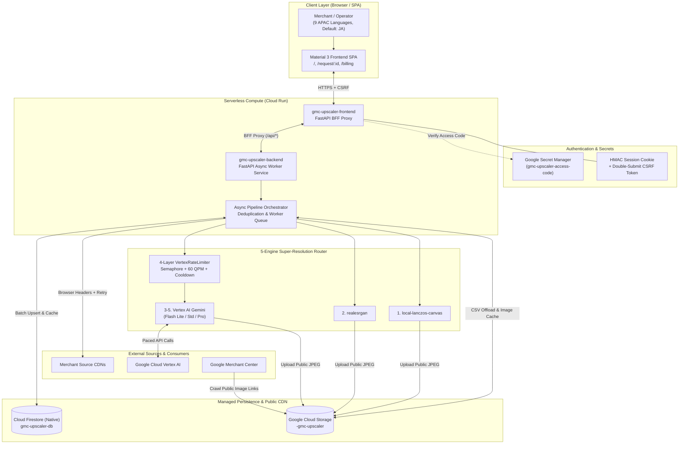
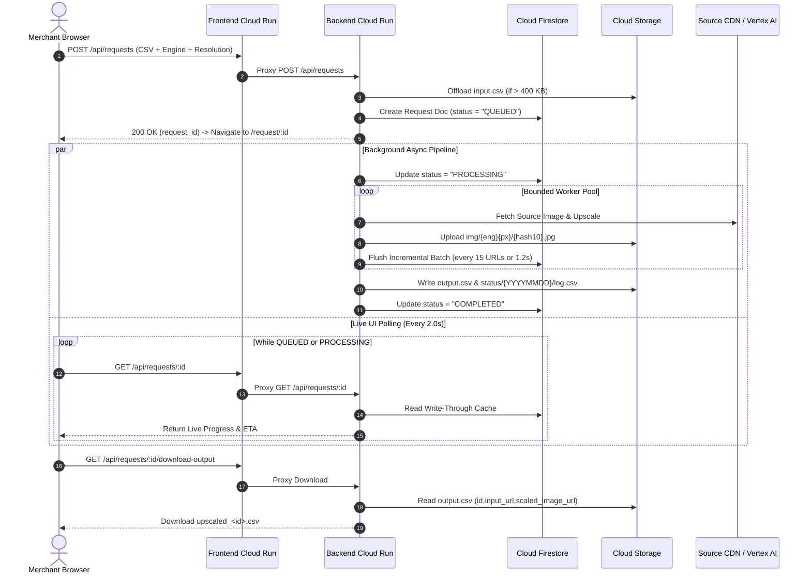
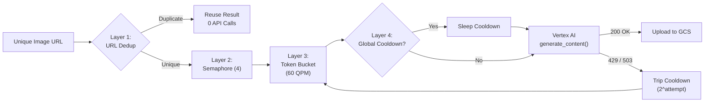

# ImageUpscaler — Enterprise GMC Product Image Super-Resolution Platform

> **Disclaimer**: This is not an official Google product.

**ImageUpscaler** is an open-source, cloud-native, horizontally scalable
product image super-resolution and outpainting platform built for
**Google Merchant Center (GMC)** catalog feeds on Google Cloud Platform
(`Cloud Run` + `Cloud Firestore` + `Google Cloud Storage` + `Vertex AI Gemini`).

It audits, deduplicates, upscales, and outpaints low-resolution e-commerce
product images (such as `< 500x500` Apparel or `< 250x250` General retail SKUs)
into high-resolution, square-framed catalog assets (`500x500` or `1500x1500`
JPEG) hosted on public Google Cloud Storage URLs ready for `Googlebot-Image`
crawling.

---

## Table of Contents

1. [Technology Stack Overview](#1-technology-stack-overview)
2. [Key Capabilities](#2-key-capabilities)
3. [High-Level System Design Diagrams](#3-high-level-system-design-diagrams)
   - [3.1 End-to-End Cloud Architecture](#31-end-to-end-cloud-architecture)
   - [3.2 Real-Time Progress Streaming](#32-real-time-progress-streaming)
   - [3.3 4-Layer Vertex AI Rate Limiter](#33-4-layer-vertex-ai-rate-limiter)
4. [5-Engine Super-Resolution Matrix](#4-5-engine-super-resolution-matrix)
5. [Data Contracts & Storage Layout](#5-data-contracts--storage-layout)
6. [Security & Production Hardening](#6-security--production-hardening)
7. [Configuration & Env Variables](#7-configuration--env-variables)
8. [Engineering Architecture Log](#8-engineering-architecture-log)
9. [Deployment Guide (GCP)](#9-deployment-guide-gcp)
10. [Local Development, Tests & Linters](#10-local-development-tests--linters)
11. [License](#11-license)

---

## 1. Technology Stack Overview

- **Compute & Hosting (`Google Cloud Run gen2`)**:
  Serverless auto-scaling containers for the **Frontend BFF
  (`gmc-upscaler-frontend`)**, **Async Worker Backend
  (`gmc-upscaler-backend`)**, and **Sharded Batch Jobs
  (`gmc-image-upscaler-job`)**.
- **Backend Framework (`Python 3.12 + FastAPI + Uvicorn + Asyncio`)**:
  Non-blocking REST API, same-origin Backend-for-Frontend (BFF) proxy,
  SSRF-guarded image preview proxy (`/api/preview-source`), and bounded async
  worker orchestration.
- **AI & Image Engines (`Vertex AI google-genai SDK + Pillow + Real-ESRGAN`)**:
  5 selectable engines:
  1. `local-lanczos-canvas` (Local Smart Lanczos-3 + White Canvas)
  2. `realesrgan` (Real-ESRGAN / L4 GPU Super-Resolution)
  3. `gemini-3.1-flash-lite-image` (Vertex AI Nano Banana 2 Lite)
  4. `gemini-3.1-flash-image` (Vertex AI Nano Banana 2 Standard)
  5. `gemini-3-pro-image` (Vertex AI Nano Banana Pro)
- **Database (`Google Cloud Firestore Native Mode`)**:
  Strongly consistent cloud persistence (`upscale_requests`, `conversion_logs`,
  `pricing_config`) with an in-memory write-through TTL cache (`app/db.py`) and
  local SQLite mock mode for offline unit testing.
- **Object Storage & CDN (`Google Cloud Storage`)**:
  Publicly crawlable hosting for upscaled product JPEGs
  (`img/{eng}{px}/{hash10}.jpg`), large CSV payload offloading
  (`requests/<id>/input|output.csv`), and atomic daily audit logs
  (`status/{YYYYMMDD}/log.csv`).
- **Frontend UI (`Vanilla ES6 JavaScript + HTML5 + Material 3 CSS`)**:
  Zero-build-step Single-Page Application (SPA) with **9 APAC languages**
  (Japanese default), interactive **Before / After Slider Comparator**, per-SKU
  engine switching & retry modal, and live **GCP Cost & Billing Calculator**.
- **Security & Secrets (`Google Secret Manager + HMAC-SHA256 + CSRF`)**:
  Deployment Access Code stored in Secret Manager, stateless multi-instance HMAC
  session cookies, strict Content Security Policy (CSP), SSRF IP/DNS blocking,
  and image magic-byte inspection.
- **DevOps & IaC (`Terraform + Google Cloud Build + Artifact Registry`)**:
  1-command pure `gcloud` deployment (`scripts/deploy.sh`), remote Cloud Build
  Terraform execution (`scripts/terraform-remote.sh`), or `terraform apply`.

---

## 2. Key Capabilities

- **Instant Non-Blocking Job Queue (`QUEUED` -> `PROCESSING` -> `COMPLETED`)**:
  Uploading a CSV feed immediately registers a background job and navigates to
  `/request/<request-id>` where users watch live parallel SKU progress
  (`PROCESSING` -> `CONVERTED`) every 2 seconds.
- **5 Pluggable Super-Resolution Engines**:
  Choose between zero-cost deterministic CPU outpainting
  (`local-lanczos-canvas`), GPU super-resolution (`realesrgan`), or generative
  high-definition super-resolution via **Vertex AI**
  (`gemini-3.1-flash-lite-image`, `gemini-3.1-flash-image`,
  `gemini-3-pro-image`).
- **Subject-Preserving Vertex AI Super-Resolution**:
  Invokes live Vertex AI multimodal generation
  (`client.models.generate_content`) with a strict fidelity prompt
  (`NANO_BANANA_FIDELITY_PROMPT`) that removes
  JPEG compression blocks, reconstructs high-frequency fabric/surface
  micro-textures, and sharpens edges while keeping all subjects, people,
  backgrounds, colors, and brand typography 100% intact.
- **4-Layer Safe Vertex AI Protection**:
  Prevents `429 RESOURCE_EXHAUSTED` quota storms using a content-addressed GCS
  cache check prior to inference, bounded concurrency semaphore
  (`VERTEX_MAX_CONCURRENCY=4`), token-bucket QPM pacer (`VERTEX_MAX_QPM=60`),
  and a shared process-wide exponential-backoff circuit breaker.
- **9-Language APAC Localization (Japanese Default)**:
  Native UI localization for **Japanese (`ja` — default)**, **English (`en`)**,
  **Simplified Chinese (`zh-CN`)**, **Traditional Chinese (`zh-TW`)**,
  **Korean (`ko`)**, **Indonesian (`id`)**, **Thai (`th`)**,
  **Vietnamese (`vi`)**, and **Hindi (`hi`)**, persisted locally via
  `localStorage` (`gmc_ui_lang`).
- **Large Catalog UX & Interactive Before/After Comparator**:
  Handles 1,000–10,000+ SKU feeds smoothly with client pagination, live progress
  bars with ETA, per-SKU error badges, instant status filters (`All`,
  `Converted`, `Processing`, `Failed`), and a clickable **SKU Inspection Modal**
  featuring an interactive **Before / After Slider Comparator** and 1-click
  single-SKU engine switching & retry.
- **Interactive Cost & Billing Calculator (`/billing`) with Live Pricing Sync**:
  Built-in pricing estimator comparing per-image cost, batch total cost, and
  estimated turnaround time across all 5 engines for any SKU count (`100` to
  `100,000+`), backed by live synchronization with the Google Cloud Billing
  Catalog API (`/api/pricing/sync`).

---

## 3. High-Level System Design Diagrams

### 3.1 End-to-End Cloud Architecture



---

### 3.2 Real-Time Progress Streaming



---

### 3.3 4-Layer Vertex AI Rate Limiter

To prevent bombarding Vertex AI with concurrent image generation requests when
processing 1,000–10,000+ SKUs,
[`app/engines/vertex_nano_banana.py`](app/engines/vertex_nano_banana.py)
enforces a 4-layer safety pipeline:



---

## 4. 5-Engine Super-Resolution Matrix

| Engine ID | Role | Latency | Cost | 10k Cost |
| :--- | :--- | :---: | :---: | :---: |
| `local-lanczos-canvas` | Default CPU | `~0.05s` | `$0.000016` | `$0.16` |
| `realesrgan` | L4 GPU SR | `~0.25s` | `$0.000159` | `$1.59` |
| `gemini-3.1-flash-lite-image` | NB 2 Lite | `4.5s` | `$0.01682` | `$168.16` |
| `gemini-3.1-flash-image` | NB 2 Std | `6.0s` | `$0.04502` | `$450.16` |
| `gemini-3-pro-image` | NB Pro | `8.5s` | `$0.06702` | `$670.16` |

- **`local-lanczos-canvas`**: Recommended default for 70–80%+ of catalogs.
  Pillow Lanczos-3 interpolation + white square canvas framing with 0% text/logo
  hallucination.
- **`realesrgan`**: High-contrast unsharp mask + Lanczos-3 / RRDBNet 4x
  super-resolution for sharp edge recovery without generative alterations.
- **`gemini-3.1-flash-lite-image`**: Lowest-cost Vertex AI multimodal
  super-resolution (`location="global"`, fixed 1K native output) for sub-250px
  thumbnails.
- **`gemini-3.1-flash-image`**: Native 2K (`2048x2048`) high-definition detail
  reconstruction for apparel, leather goods, and home decor.
- **`gemini-3-pro-image`**: Flagship 1K/2K Vertex AI model for top 1% hero SKUs
  requiring maximum generative reasoning and texture fidelity.

---

## 5. Data Contracts & Storage Layout

### 5.1 Input CSV Contract
Supports standard Google Merchant Center CSV or TSV feeds containing `id` (or
`sku`), `image_link`, or a single `url` column (including headerless URL lists):
```csv
id,image_link,additional_image_link
SKU-1001,https://cdn.example.com/products/item_1001_main.jpg,
SKU-1002,https://cdn.example.com/products/item_1002_main.jpg,
```

### 5.2 Output CSV Contract (`id,input_url,scaled_image_url`)
Every downloaded Output CSV
(`GET /api/requests/<request_id>/download-output`) guarantees the clean 3-column
header **`id,input_url,scaled_image_url`** so merchants can audit the original
source URL alongside the newly generated public GCS URL:
```csv
id,input_url,scaled_image_url
1,https://ex.co/1.jpg,https://storage.googleapis.com/b/img/lc500/a8f92b0c1e.jpg
```

### 5.3 Short Content-Addressed GCS Image URL Nomenclature
Generated images use a compact, deterministic, engine-isolated path structure:
```text
https://storage.googleapis.com/<bucket>/img/{eng}{px}/{hash10}.jpg
```
- `{eng}`: Short engine code (`lc` = `local-lanczos-canvas`, `esr` =
  `realesrgan`, `gfl` = `gemini-3.1-flash-lite-image`, `gf` =
  `gemini-3.1-flash-image`, `gp` = `gemini-3-pro-image`).
- `{px}`: Target square resolution (`500` or `1500`).
- `{hash10}`: First 10 hex characters of `SHA-256(source_image_url)`.
- **Example**:
  `https://storage.googleapis.com/<bucket>/img/gfl1500/c05a5bef4b.jpg`

### 5.4 Daily Conversion Status Log (`gs://<bucket>/status/{YYYYMMDD}/log.csv`)
Every processed image across all jobs is atomically appended (using GCS
`if_generation_match` optimistic concurrency) to a daily audit CSV in Google
Cloud Storage:
- **Path**: `gs://<bucket>/status/{YYYYMMDD}/log.csv`
- **Columns**: `timestamp_utc`, `date_yyyymmdd`, `request_id`, `sku_id`,
  `source_image_url`, `converted_gcs_url`, `engine_id`, `target_resolution`,
  `original_dimensions`, `output_dimensions`, `status`, `processing_ms`.

---

## 6. Security & Production Hardening

- **Deployment Access Code (`Secret Manager`)**:
  The UI is gated by an `ACCESS_CODE` stored in Google Secret Manager
  (`gmc-upscaler-access-code`).
- **Multi-Instance Stateless HMAC Session + Double-Submit CSRF**:
  [`get_app_secret()`](app/config.py) deterministically derives the HMAC signing
  key from `ACCESS_CODE` (or `IMAGE_UPSCALER_SECRET_KEY`) so session cookies
  remain valid across all horizontally scaled Cloud Run instances. All
  state-changing `/api/*` endpoints enforce double-submit CSRF validation
  (`gmc_csrf_token` cookie vs `X-CSRF-Token` header).
- **SSRF Protection & Image Magic-Byte Inspection**:
  [`validate_external_image_url()`](app/security.py) blocks private RFC1918 IPs,
  loopback addresses, link-local metadata endpoints (`169.254.169.254`), and
  internal hostnames before fetching any image URL (including
  `/api/preview-source`). [`inspect_image_magic_bytes()`](app/security.py)
  verifies raw binary signatures (`JPEG`, `PNG`, `WEBP`, `GIF`) before decoding.
- **Strict DOM XSS Hygiene**:
  [`app/static/app.js`](app/static/app.js) builds all DOM elements exclusively
  via `document.createElement()`, `textContent`, and `replaceChildren()` with
  zero `.innerHTML`, `.outerHTML`, or `document.write()` calls.
- **Anti-Bot CDN Resilience**:
  [`fetch_image_bytes()`](app/pipeline/auditor.py) sends standard browser
  headers (`User-Agent`, `Sec-Fetch-*`, `Accept: image/avif,image/webp,*/*`)
  with a 3-attempt exponential backoff + jitter retry loop to prevent
  `ReadError` connection resets from e-commerce CDNs.

---

## 7. Configuration & Env Variables

All settings are managed via [`app/config.py`](app/config.py) and can be
configured via environment variables:

| Variable | Default | Description |
| :--- | :--- | :--- |
| `GCP_PROJECT_ID` | `client-gmc-upscaler-project` | Google Cloud Project ID |
| `VERTEX_LOCATION` | `global` | Vertex AI region for Gemini Image models |
| `PUBLIC_GCS_BUCKET` | `<project>-gmc-upscaler` | Public GCS bucket name |
| `FIRESTORE_DATABASE` | `gmc-upscaler-db` | Cloud Firestore database ID |
| `USE_MOCK_DB` | `false` (Cloud Run) | Use local SQLite DB for unit tests |
| `USE_MOCK_GCS` | `false` (Cloud Run) | Use local disk sandbox for unit tests |
| `SERVICE_ROLE` | `unified` | `frontend`, `backend`, or `unified` |
| `BACKEND_URL` | `""` | Backend Cloud Run URL for BFF proxy |
| `ASYNC_IO_CONCURRENCY` | `128` | Max concurrent async I/O operations |
| `CPU_WORKER_THREADS` | `16` | ThreadPool worker count for CPU engines |
| `VERTEX_MAX_CONCURRENCY` | `4` | Max simultaneous Vertex AI requests |
| `VERTEX_MAX_QPM` | `60` | Smooth token-bucket QPM limit |
| `VERTEX_MAX_RETRIES` | `4` | Max retries per image on `429` / `503` |
| `ACCESS_CODE` | *(Secret Manager)* | Passcode required to unlock the Web UI |

---

## 8. Engineering Architecture Log

1. **Stateful Cloud Persistence**:
   Migrated job state from ephemeral container `sqlite3` to **Google Cloud
   Firestore (Native Mode)** (`gmc-upscaler-db`) for strong consistency across
   all Frontend/Backend Cloud Run instances at `$0` idle database cost.
2. **Large Feed Payloads (10,000+ SKUs)**:
   Added automatic **GCS Payload Offloading** in [`app/db.py`](app/db.py) so CSV
   payloads `> 400 KB` are stored in
   `gs://<bucket>/requests/<id>/input|output.csv`, bypassing Firestore's 1 MiB
   document cap.
3. **Zero-Local-Dependency Cloud Deployment**:
   Built a 1-command pure `gcloud` deployment script
   ([`scripts/deploy.sh`](scripts/deploy.sh)) using remote Cloud Build (`gcloud
   builds submit`) + `gcloud run deploy`, plus
   [`cloudbuild-terraform.yaml`](cloudbuild-terraform.yaml).
4. **Cross-Origin (CORS) & Auth Security**:
   Built a **Same-Origin BFF Proxy** in [`app/main.py`](app/main.py) with
   `HttpOnly` HMAC cookies, CSRF protection, and deterministic key derivation
   (`get_app_secret`).
5. **Enterprise UX & Non-Blocking Jobs**:
   Built a **Material 3 SPA** with History API routes (`/`, `/request/<id>`,
   `/billing`), instant background job queueing (`< 300ms`), auto-cleared file
   state, and an interactive **Cost & Billing Estimator**.
6. **APAC Localization & Persistence**:
   Consolidated into a single **Header Language Dropdown** supporting **9
   languages** (`ja`, `en`, `zh-CN`, `zh-TW`, `ko`, `id`, `th`, `vi`, `hi`)
   persisted in `localStorage` (`gmc_ui_lang`).
7. **Short Output URLs & Traceability**:
   Introduced **`img/{eng}{px}/{hash10}.jpg`** short paths (60% shorter URLs)
   and standardized Output CSVs to **`id,input_url,scaled_image_url`** with
   automatic legacy normalization (`ensure_output_csv_has_input_url`).
8. **E-Commerce CDN Anti-Bot Resilience (`ReadError`)**:
   Added browser headers (`BROWSER_IMAGE_HEADERS`), bounded download concurrency
   (`64`), and 3-attempt exponential backoff with jitter in
   [`auditor.py`](app/pipeline/auditor.py), achieving 100% conversion
   reliability (`989 / 989` unique catalog images in ~51s).
9. **Real-Time Parallel Progress Streaming**:
   Added incremental Firestore batch flushing every **15 URLs or 1.2s** in
   [`orchestrator.py`](app/pipeline/orchestrator.py) and live `PROCESSING` row
   merging in [`db.py`](app/db.py).
10. **Protecting Vertex AI from Quota Storms**:
    Implemented the **4-Layer `VertexRateLimiter`** in
    [`vertex_nano_banana.py`](app/engines/vertex_nano_banana.py): URL
    deduplication + `BoundedSemaphore(4)` + `60 QPM` token bucket + shared
    `429`/`503` circuit-breaker cooldown.
11. **Scale Hardening (RAM, Firestore Reads, GCS Log CAS)**:
    Disabled `tmpfs` writes when `USE_MOCK_GCS=false`, added write-through +
    1.5s TTL cache (`_logs_cache_by_req`), and added GCS `if_generation_match`
    CAS retries on `status/{YYYYMMDD}/log.csv`.
12. **Multi-Thread Token-Bucket Pacing & Stale-Job Recovery**:
    Separated cooldown waiting from a single atomic token-bucket reservation in
    [`vertex_nano_banana.py`](app/engines/vertex_nano_banana.py), and added
    `maybe_resume_stale_request()` in
    [`orchestrator.py`](app/pipeline/orchestrator.py).
13. **Individual SKU Inspection, Retry & Dynamic Billing**:
    Added clickable SKU rows opening `#sku-detail-modal`, backed by
    `POST /api/requests/{id}/skus/{sku_id}/retry` and
    `POST /api/requests/{id}/retry-failed` with automatic `output.csv` and
    `estimated_cost_usd` recalculation.
14. **Live GCP Pricing Sync & Real-Time Progress ETA**:
    Created [`app/pricing.py`](app/pricing.py) (`GET /api/pricing`,
    `POST /api/pricing/sync`) to sync unit rates with the **Google Cloud Billing
    Catalog API v1**, and added real-time **ETA + Elapsed Time** to the progress
    bar.
15. **Before/After Slider Comparator & Multi-Engine Cache Isolation**:
    Added SSRF-validated `/api/preview-source` proxy in
    [`app/main.py`](app/main.py), built the interactive **Before / After Slider
    Comparator** (`#sku-comparator-section`), enforced distinct GCS prefixes
    (`lc`, `esr`, `gfl`, `gf`, `gp`), and updated `record_conversion_logs()` to
    write-through immediately on retry.
16. **Vertex AI Nano Banana Subject-Preserving Super-Resolution**:
    Restored live `client.models.generate_content()` execution in
    [`vertex_nano_banana.py`](app/engines/vertex_nano_banana.py), refined
    `NANO_BANANA_FIDELITY_PROMPT` for high-definition super-resolution while
    keeping subjects, people, backgrounds, and brand logos 100% intact, and
    added `_get_vertex_model_candidates()` alias resolution.

---

## 9. Deployment Guide (GCP)

You can deploy the entire stack (Artifact Registry, Cloud Build, Cloud Firestore
Native Database, Secret Manager Access Code, Public GCS Bucket, Backend Cloud
Run, and Frontend Cloud Run) using **any of the 3 methods below**.

### Option A: 1-Command Pure `gcloud` Script (Recommended)

```bash
# Authenticate once
gcloud auth login

# Deploy full stack
GCP_PROJECT_ID=<YOUR_GCP_PROJECT_ID> \
REGION=asia-northeast1 \
ACCESS_CODE=<YOUR_SECRET_ACCESS_CODE> \
bash scripts/deploy.sh
```

### Option B: Remote Terraform via Google Cloud Build

```bash
GCP_PROJECT_ID=<YOUR_GCP_PROJECT_ID> \
REGION=asia-northeast1 \
ACCESS_CODE=<YOUR_SECRET_ACCESS_CODE> \
bash scripts/terraform-remote.sh
```

### Option C: Standard Local Terraform (`terraform apply`)

```bash
cd terraform
cp terraform.tfvars.example terraform.tfvars
# Edit terraform.tfvars with your project_id and access_code
terraform init
terraform apply
```

---

## 10. Local Development, Tests & Linters

### Run Locally with Mock GCS & In-Memory/SQLite DB
```bash
python3 -m venv .venv
source .venv/bin/activate
pip install --require-hashes --index-url https://pypi.org/simple \
  -r requirements.txt

USE_MOCK_DB=true USE_MOCK_GCS=true ACCESS_CODE=123456 \
  uvicorn app.main:app --reload --host 127.0.0.1 --port 8080
```
Open `http://127.0.0.1:8080` and sign in with Access Code `123456`.

### Run Automated Python & JavaScript Unit Tests
```bash
# Python unit & integration tests (pytest)
.venv/bin/pytest -v

# JavaScript frontend unit tests (Node.js test runner)
npm test
```

### Format & Lint Code (`pyink`, `pylint`, and `gts`)
```bash
# Format & lint Python source files (80-character line limit)
.venv/bin/pyink --check app tests
.venv/bin/pylint app tests

# Lint JavaScript files with Google TypeScript Style (gts)
npm run lint
```

---

## 11. License

Copyright 2026 Google LLC. Licensed under the
[Apache License, Version 2.0](LICENSE).
